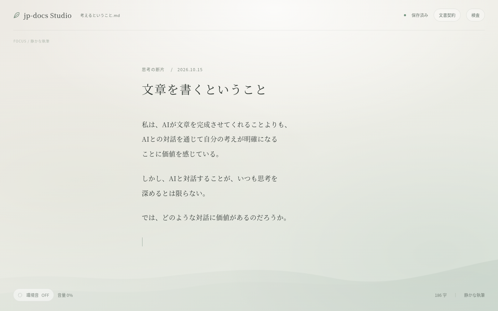
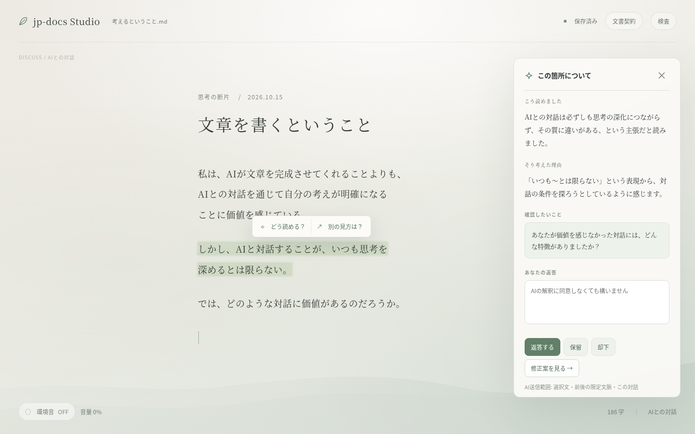
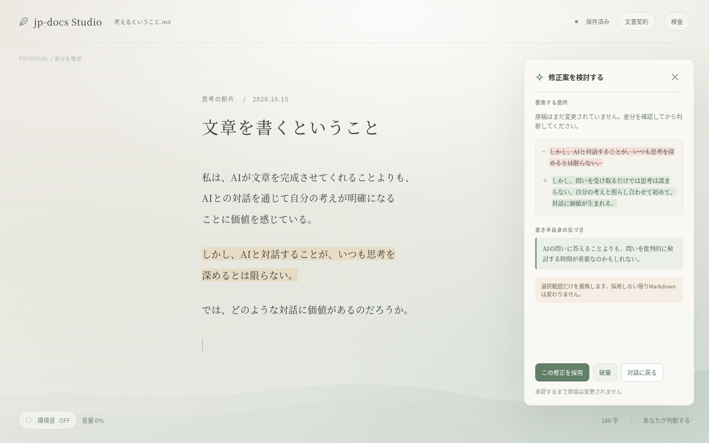
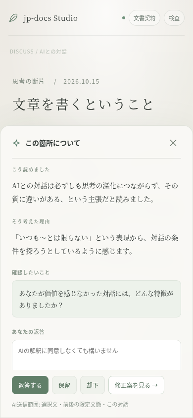

# jp-docs Studio — 画面デザイン・操作仕様 v0.3

作成: 2026-10-15 / 対象: `tanabe1478/jp-docs-harness` の `studio/`

この文書は実装指示書 `jp-docs-studio-agent-handoff-v0.3.md` を補足する**画面・操作の基準**です。画像は動作を説明する静的モックであり、スクリーンショット内のラベルをAPIや機能の実装済み証拠とみなさないこと。

## このデザインで守りたい体験

- **静けさがデフォルト**。本文を読む・書くときはAIの存在を忘れられる。
- **AIは呼び出すまで介入しない**。入力や保存ではモデルを呼ばない。
- **本文の場所が動かない**。デスクトップでパネルを開閉してもエディタの幅・改行位置・スクロール・選択箇所を維持する。
- **AIは読者の一人**。解釈は提案・仮説であり、書き手の意図の代弁ではない。
- **決定権は書き手にある**。置換案は差分を表示し、承認されるまでMarkdownを書き換えない。
- **OmmWriterから抽象的原則だけ学ぶ**。特定の背景画、アイコン、レイアウト、操作アニメーション、効果音の模写は禁止。

全体の構成は [画面一覧](design/screens-overview.png) でも確認できる。

## 画面1 — 静かな執筆（Focus）

起点となる画面。AIのパネルやチャット履歴を常時表示しない。長文の入力・選択に集中でき、同じUIから文書契約の参照と明示的な検査実行を行える。保存済み / 編集中 / 保存失敗 / 競合は、テキストと状態で区別する。

- 中央の執筆カラムは **620px（最初の参考値、最大680〜740px以内で調整可）**。日本語本文19px前後、約2.1〜2.25の行間。明朝系フォールバックと読みやすさを両立。
- 本文に本文以外の「AIへの指示」などを勝手に埋め込まない。Markdownの正本性は維持。
- アプリヘッダは控えめ。初期状態の環境音はOFF。提供する背景・音はオリジナルかライセンスを明示できるものだけ。
- 画面中の文言・字数はサンプル。字数は実際の内容から計算し、保存完了はサーバーの確定を受けて表示する。

## 画面2 — 選択から対話（Discuss）

利用者が選択した箇所にだけ控えめなハイライトを表示し、短いアクション「どう読める？」「別の見方は？」を提供する。ユーザーが選ぶまではAI呼び出ししない。AIの応答で右側にパネルを表示する。

- AIパネルは右側に**重ねる**。デスクトップ時は**エディタの文面座標・行折り返し・スクロール位置が変わらない**こと。余裕のない幅ではパネルと本文を同時に見せようとせず、モバイルのシート表示へ切り替える。
- パネル幅は約**346px**。見せる順番は「こう読めた」「そう考えた理由」「確認したいこと（原則1件）」「あなたの返答」。
- AIが誤読していれば本人は「違う」と言える。保留・却下・再開は成功する操作であり、無理に本文修正へ誘導しない。
- 原稿からモデルへ送るのは選択範囲・前後の限定文脈・当該対話だけ。プロバイダーと送信範囲を分かるようにする。
- AI未設定、送信中、応答なし、エラー、古くなったアンカーは別のUI状態を用意。画像のAI文章は**例示**であって固定レスポンスをハードコードしない。

## 画面3 — 変更を判断する（Proposal）

AIが返すのは選択テキストだけの置換案。左右diffまたはインラインdiffで原文と候補を区別し、「採用」「破棄」の判断を**書き手が明示**して行う。

- 生成・閲覧・スクロールではMarkdownを変更しない。**採用したときだけ**、現在の文章ハッシュとアンカーをサーバー側で検証して反映する。
- 変更が入っている場合はHTTP 409として適用拒否。再選択を促し、強制適用ボタンは置かない。
- 書き手のInsight（気づき）は**本人が入力・保存したもの**で、AIが生成して勝手に記録したものではない。
- 差分を色だけで区別しない。`−/＋` 記号や文言、アクセシビリティラベルを併用する。
- デスクトップのエディタはFocus/Discussと同じ座標に置き、変更採用前後の再flowが意図せず生じないようにする。

## 参考 — 狭い画面

端末幅390pxの参考例。パネルは横に縮めるのではなく、下から現れるシートとして表示。内容部分のみスクロールでき、閉じる・返答・保留・却下・提案の操作は見つけられること。実際の編集・キーボード表示・スクリーンリーダー操作はE2Eで別途確認する。

## レイアウト・デザイントークン

| 項目 | 初期参考値 | 備考 |
| --- | --- | --- |
| 背景 | `#EDEAE4` → `#DCE4DC` | CSSの控えめなグラデーション・抽象的な光と丘。風景画像のコピー不可 |
| 本文 | `#343B38` | 背景と十分なコントラストを確保 |
| 補助文字 | `#707A72` | 小文字サイズの可読性を実機で確認 |
| AI強調 | `#577C69` | 原稿の主張を隠さず、落ち着いたセージ系 |
| パネル | `rgba(250, 249, 245, 0.95)` | 高すぎない影、視線を奪わない境界線 |
| 文書カラム | 620px / デスクトップ例 | 制約は最終的に最大680〜740px以内で判断 |
| AIパネル | 346px / デスクトップ例 | **開閉で文書幅を変えない** |
| 本文 | 19px / 2.25 | フォントサイズ・行間をユーザーが調整可能にする余地を残す |
| タイトル | 34px / Noto Serif CJK JPなど | 実装の必須フォントではない。OSフォントでフォールバック |
| ヘッダ | 88px | 入力中の視覚ノイズを抑える |
| モバイル | 390px例 | 幅680px以下は全幅の下部シートを参考にする |

カラートークン・余白・丸み・シャドウ・アニメーションをCSS変数/デザイントークンで表現する。背景装飾は文字コントラスト・性能・省電力・動きの低減に影響しない程度に限定。

## 状態遷移・操作の対応

| 状態/トリガー | UI | 状態の責任 | テスト |
| --- | --- | --- | --- |
| Markdownを開く | Focus表示 | 原稿はサーバー上のMarkdownが正本 | A-01 |
| 文章を入力 | Focus維持、保存待ち表示 | 変更は保存成功時にのみ確定表示 | A-01, A-02 |
| テキストを選択 | ハイライトと控えめなアクション | 無選択時はアクション無効 | B-01 |
| 「どう読める？」 | Discussパネル、ローディング表示 | AiAdapterが限定コンテキストだけ送信 | B-01, B-02 |
| AI応答 | 読解・理由・質問を分けて表示 | 内容は仮説、本人の意図として記録しない | B-01 |
| 返答/保留/却下 | 同じ段落のThreadに履歴/判断を保存 | レビュー結果と混同しない | B-03, B-04 |
| Insightを保存 | 自分の言葉が後から参照できる | 本人入力のみ | B-03 |
| 「修正案を見る」 | Proposalのdiffに切り替わる | ここでは原稿を変更しない | C-01 |
| 採用 | ハッシュとアンカー照合して該当範囲だけ適用 | 古い提案の強制適用不可 | C-02, C-03 |
| 「検査」 | 既存CLIのfindingを表示 | Studio固有の架空判定は作らない | C-04 |
| パネルを閉じる | Focusへ。カーソルとスクロール維持 | 本文カラム幅・行折返し不変 | UX-01, UX-02 |

## 再現度の判断順

1. 文章の改変を本人が支配できること・データの保全・状態の正確さ。
2. 段落選択からAIとの対話に至る自然さ。AIの問いにより思考が進められること。
3. Focus/Discuss/Proposalで**文章の位置が変わらない**こと、読みやすい文字組み。
4. 余白、色、パネルの位置、背景の落ち着きといったビジュアル再現。
5. 装飾、背景の精細さ、アニメーション（MVPでは控えめでよい）。

スクリーンショットのピクセルパーフェクト一致は要求しない。**大枠の構成、相対的な密度、操作上の不変条件**を優先する。問題があれば仕様とスクリーンショットの不一致を報告し、本文のデータ保全を優先する。

## ソースとムードボード

- `design/studio-mockups.html`：今回の画面イメージを組み立てた**静的HTML/CSS**。デザイントークン、寸法、レイアウトの参照として使える。**Markdown編集・サーバー保存・AI連携などの機能は実装されていない。**
- `design/focus-desktop.png`、`dialog-desktop.png`、`proposal-desktop.png`、`dialog-mobile.png`：テキストが読める具体的な画面参照。
- `design/atmosphere-moodboard.png`：発想段階のAI生成コンセプト画。文字や配置の正確性は保証しない。テーマ切替、統計、文書階層などの**MVP対象外の機能も描かれているため、この画像だけを見て実装範囲を増やさない**。

**優先順位**：実装指示書 v0.3 > 本画面仕様 > 各画面の静的HTML/PNG > ムードボード。矛盾があれば上位が正。
